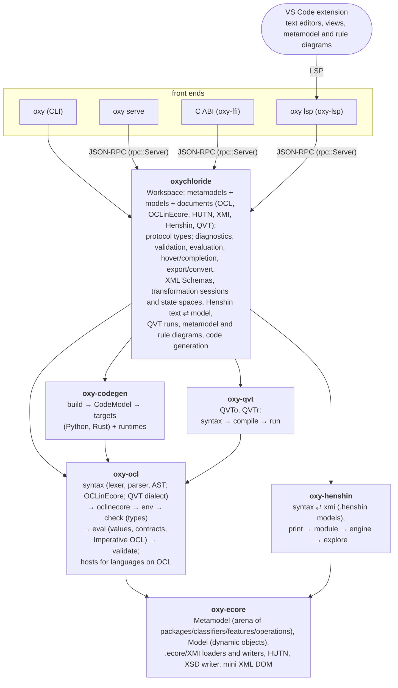

# Architecture

## oxy-ecore

- `Metamodel` stores every loaded `EPackage` in arenas addressed by small `Copy` ids (`PackageId`, `ClassifierId`, `FeatureId`, `OperationId`). It only grows, so ids stay valid. Inheritance closures and feature lookup tables are recomputed after each load.
- `Ecore.ecore` is embedded (`builtin.rs`) and loaded by the same loader, so references like `ecore:EDataType http://www.eclipse.org/emf/2002/Ecore#//EString` resolve uniformly.
- `.ecore` loading is two-pass over a small DOM: build elements, then resolve `eType`/`eSuperTypes`/`eOpposite` hrefs (same file, by nsURI, or by relative path, loading referenced files on demand through a `Fetch` that may map URIs to other locations — the workspace's package registry; cycles work because a resource is registered before its references are resolved). Unresolvable references are warnings, not errors.
- `Model` holds dynamic objects (`ObjectId`) with per-feature value lists. `Model::add` maintains containment and `eOpposite` consistency, which is what makes navigating the non-serialized side of a bidirectional reference work after loading XMI. For changing models (QVT), `insert`, `set`, `clear`, `remove`, `detach` and `delete` behave like EMF: an object added to a containment feature leaves its previous container (or the roots of its resource), a single-valued feature or opposite drops the link it had, a deleted object leaves every feature that referred to it.
- XMI loading supports single-root and `xmi:XMI` multi-root documents, `xsi:type`, attribute and element-encoded values, `//@feature.index` fragments, name-based fragments and `xmi:id`s, and type-checks resolved references.
- Metamodels can also be built element by element (`add_resource`, `add_package`, … `finish_resource`), which is how OCLinEcore documents become packages. `ecore_writer` and `xmi_writer` serialize resources back to `.ecore` and XMI; derived, transient and container references are not written, and of a bidirectional pair of references only one side is.
- `hutn` parses HUTN (lexer, recovering parser producing an AST with byte ranges), loads it into a `Model` as a new resource (two passes: objects, then references by identifier; then multiplicity checks), reporting `Problem`s with ranges rather than failing, and prints a model resource as HUTN. The parser is metamodel-independent: whether a top-level block is a package block or an object is decided when loading.
- `xsd_writer` generates an XML Schema per package (EMF's XMI conventions: qualified root elements, unqualified children and attributes, one complex type per class extending its first supertype, an unbounded choice of child elements) plus one for the XMI namespace, so XML tools can check XMI files structurally.

## oxy-ocl

- **Syntax**: a hand-written lexer and recursive-descent/precedence-climbing parser. Document keywords (`context`, `inv`, `body`, …) are *not* reserved inside expressions (a model may well have a feature called `body`); the parser disambiguates by the following token. The parser never fails: errors become diagnostics plus `Error` nodes, and document-level recovery resynchronizes at the next `context`/`inv`/`def`/….
- **Environment** (`env.rs`): `EnvironmentBuilder` collects sources — Complete OCL documents and expressions from Ecore annotations — resolves contexts (with package scoping) and registers invariants, `def:` attributes/operations, operation bodies, derivations and initializers. `build()` type checks everything once all definitions are known, so documents can use each other's definitions.
- **Type checker** (`check.rs`): computes a `Type` for every expression (kept, with spans, for hovers and completion) and reports errors. `Type::Error` marks "already reported / unknown" and is accepted everywhere, which prevents cascades.
- **Analysis** (`resolution.rs`): while checking, the checker also records per expression id its type and how its names, properties and calls were resolved (variable, implicit `self`/iterator property, feature, `def:`, operation, library operation, implicit collect). `Environment::analysis` exposes it for tools that translate OCL (the code generators), so the resolution rules are not repeated a third time.
- **Evaluator** (`eval.rs`): a tree-walking interpreter over the same AST. Name resolution mirrors the checker (variables, then implicit-iterator/`self` properties, then types). Values (`value.rs`) are cheap to clone (`Rc`). Set semantics use a structural `Key` that agrees with OCL equality (e.g. `1 = 1.0`). Evaluation never panics on bad input: errors are `invalid` values that propagate per OCL's strictness rules, with the usual non-strict exceptions (`and`/`or`/`implies`, `oclIsUndefined`, `oclIsInvalid`). Recursion through definitions is bounded.
- **OCLinEcore** (`syntax/parser/oclinecore.rs`, `oclinecore.rs`): the parser is a child of the OCL parser and parses embedded expressions on the same token stream, so their spans are document offsets. `build` adds the document's packages to a metamodel in passes (declare classifiers, then members, then opposites once inheritance caches exist), stores the OCL as Pivot annotations (as Eclipse does, so export works), and returns the constraints with their owners. `EnvironmentBuilder::add_oclinecore` registers those constraints against the document source — not the annotations — so diagnostics, hovers and completion work on the document. `print` renders a resource back as OCLinEcore.
- **Contracts** (`eval.rs`): when an operation with an OCL body is called, the pre- and postconditions of it and of the operations it overrides are evaluated (postconditions with `result`); failures are recorded in the evaluator (`take_contract_checks`) and do not change the call's result. `@pre` evaluates to the current value: OCL queries have no side effects.
- **Imperative OCL and hosts** (`syntax/parser/imperative.rs`, `host.rs`): in the QVT dialect (`Dialect::Qvt`) the lexer reads `//` comments, double-quoted strings, `:=`, `+=`, `!=` and `++`, and expressions include Imperative OCL (blocks, `var`, assignments, `while`, `forEach`, `switch`, `return`, `log`, `assert`, …) and the expressions of QVT Operational Mappings (`object`, `map`, `resolve`, `new`) — the words are not reserved: they start such an expression only when the next token fits. The `Parser` is public, for languages that parse their documents on the same token stream (`oxy-qvt`). The checker and the evaluator handle Imperative OCL and ask a `CheckHost`/`Host` for what depends on the language (its names, operations, mappings, objects to create, `resolve`), with package aliases (QVT's model types) for type names; names are looked up in the same order by both. The evaluator can change the model (`Evaluator::new_mut`); `return`/`break`/`continue` are a pending state taken by blocks, loops and call frames (`call_frame`), and problems of statements are collected with their spans. Evaluation and checking grow the stack when it runs low, so deep recursion ends at the depth limit with `invalid`, not with a stack overflow.
- **Validation** (`validate.rs`): every invariant is evaluated on every instance (including subclass instances) of its context class, with `allInstances()` restricted to the object's resource (`Evaluator::set_extent`), as Eclipse OCL's validation does (and generated code); evaluating an expression outside validation sees all models. With contracts, every operation that has postconditions is also called on every applicable object with all argument combinations from finite domains (Boolean, enumeration literals, model objects; capped per object); calls whose preconditions fail are skipped. Operations with other parameter types, or without a body, are reported as unchecked.

## oxy-henshin

Graph transformations in both notations of Henshin: its textual syntax (`.henshin_text`; the Xtext grammar of `org.eclipse.emf.henshin.text`) and its model (`.henshin`, the XMI its graphical editors write). It depends on `oxy-ecore` only: Henshin's attribute expressions are not OCL. See [HENSHIN.md](HENSHIN.md) for how the two notations map onto each other.

- **Syntax** (`syntax.rs`): lexer and recovering recursive-descent parser over the whole grammar (imports, rules with parameters, `graph`s of nodes, `reuse`, `edges`, attributes, `multiRule`s, `matchingFormula`s with condition graphs, `conditions`, `checkDangling`, `injectiveMatching`, `javaImport`; units: calls, `{...}`, `strict`, `rollback`, `independent`, `priority`, `if`/`then`/`else`, `for`, `while`; the expression language). Errors are `Problem`s with byte ranges; parsing resumes at the next element.
- **Printing** (`print.rs`): syntax trees back to text, in the layout of Henshin's examples; the inverse of the parser up to layout and comments.
- **Models** (`xmi/`): `read` turns a `.henshin` file into the syntax tree of the textual syntax (spans in the XML), so one compiler serves both notations; it reconstructs actions from the left- and right-hand sides and their mappings, `forbid`/`require` elements and matching formulas from nested conditions, `reuse`s from multi-rule copies, nested blocks of units from the units marked `henshin_text:nested`, call arguments from parameter mappings, names for unnamed nodes. `write` writes a *compiled* module (so the file means what the engine runs), taking the file it replaces as a `Template`: ids and what the text cannot express (descriptions, annotations, …) are kept by element keys made of names (renamed rules, units and nodes are recognized by position), new elements get ids derived from their keys, so writes are deterministic. Attribute expressions are JavaScript in the model; `js.rs` parses the part of JavaScript the textual syntax can express and prints expressions as JavaScript (other JavaScript is kept as `javascript("…")`).
- **Modules** (`module.rs`): resolves a document against a `Metamodel` into executable `Rule`s and `Unit`s, reporting problems and recording a description of every resolved name (for hovers) and the names visible in each region (for completion). A rule's nodes are its left- and right-hand side (preserved, deleted, created) and share indices with the slots of a match; `forbid` and `require` elements become one negative and one positive `ConditionGraph`, formulas a tree of `Condition`s over condition graphs whose nodes get further slots. A multi-rule starts with copies of its kernel's nodes (same indices), so a kernel match seeds its matches. Parameters named like nodes are node parameters.
- **Graphs** (`graph.rs`): a `Graph` is the transformable form of a model resource (`from_model`, `to_model`): nodes with stable ids that are never reused (deleted nodes leave a hole), links kept consistent like EMF does (opposites, single-valued replacement, containment moves, no containment cycles). `fingerprint` (Weisfeiler–Lehman colour refinement over classes, attribute values and links) and `isomorphic` (backtracking over equally coloured nodes) decide whether two states are the same up to object identity. `migrate` maps a graph onto a rebuilt metamodel by qualified names.
- **Engine** (`engine.rs`): matching is a backtracking search that extends from matched nodes along links (forward, or backward through opposites), checks attribute values as nodes are matched — a lone unbound parameter is bound to the value, other expressions wait until their parameters are bound — then the attribute conditions, the application condition (condition graphs are searched as extensions of the match) and, for complete matches, the dangling condition of the amalgamated changes. Applying a match first collects a plan (deleted links and nodes, created nodes, attribute values, created links; multi-rule matches add to it), then performs it. Units are interpreted over the graph with Henshin's semantics (snapshots for rollback, a seeded random order for independent units, a bound on rule applications so that loops end).
- **State spaces** (`explore.rs`): breadth-first, every match of every selected rule, new states merged with known isomorphic ones (fingerprint buckets, then the isomorphism check), limited by a number of states and a depth. States keep the transition they were first reached by, so the shortest path to a state is known and its graph derives from its predecessor's (ids stay comparable along the path).

## oxy-qvt

QVT transformations (see [QVT.md](QVT.md)): Operational Mappings (`operational/`) and Relations (`relational/`), each parsed (`syntax.rs`: the document parsers of Eclipse QVTo's and QVTd's grammars, on `oxy-ocl`'s parser in the QVT dialect), compiled (`compile.rs`) and run (`run.rs`). It depends on `oxy-ecore` and `oxy-ocl` only; `library.rs` has QVT's standard library operations besides OCL's (type checking and evaluation).

- **Compiling** resolves model types (QVTo) or imports (QVTr) to packages through a lookup the caller gives (the workspace knows the package registry and where documents are) and makes them `PackageAlias`es; a QVTo document is compiled with the units it imports (found through a second lookup; each parsed at its own span offset, so diagnostics and run problems are traced to their files, and checked with its own aliases), its libraries' and extended transformations' elements merged into the transformation (closer modules override), accessed transformations compiled on their own; it gives mappings, helpers, queries and properties typed signatures, resolves the templates of relations against the metamodel (classes, features, the types of their variables; unnamed templates get fresh variables), and type checks every body and predicate with OCL's checker — for QVTo with the transformation as its `CheckHost`. The result (`Compiled`) has the diagnostics, the types of the checked expressions with their spans, the variables of each body (for completion), the declarations (for hovers) and the parameters.
- **Running QVTo**: the run is the evaluator's `Host` on a mutable model whose resources the parameters are bound to. Mapping calls are dispatched by the source's runtime type (the most specific context), answered from the trace if the mapping was applied to the same values, else executed in a call frame (guard, `init`, creating null results in their extent, recording the trace, inherited mappings, the population with the result as implicit object, `end`, merged mappings, `where`); `resolve` searches the trace, `late resolve` assignments are deferred to the end. Objects of `in` extents cannot be changed.
- **Running QVTr** in the direction of a parameter: a fixpoint over the top relations; for each binding of the source domains that satisfies `when` (relation calls are looked up in the trace), check before enforce (match the target pattern), else enforce it (bound objects, objects identified by keys, new ones; properties set as EMF does), record the binding and apply `where` (relation calls applied with the given roots, the overriding relations of abstract ones). Check mode reports the bindings whose target pattern does not match.

## oxy-codegen

Code generation (see [CODEGEN.md](CODEGEN.md)): native domain models with their OCL translated, for Python and Rust. It depends on `oxy-ecore` and `oxy-ocl` only.

- **Build** (`build.rs`): the selected packages plus those they depend on become a `CodeModel` (`model.rs`), a self-contained, index-based description of packages, classes, enumerations, features (typed, nullable or not, with defaults), operations (with the operations they override) and their OCL. Targets never look at the `Metamodel`.
- **Lowering** (`lower.rs`): OCL bodies become resolved, typed `Expr` trees, using the checker's `Analysis`: implicit sources and collects explicit, single values used with `->` wrapped in `oclAsSet`, canonical library operation names (`library.rs`), unique variable names. Untranslatable OCL (and OCL with errors) becomes `Invalid` nodes plus warnings.
- **Targets** (`python.rs`, `rust.rs`, registered in `TARGETS`) print the code model, and copy a runtime (`runtime/<language>/`: the OCL library, consistent links, XMI, multiplicities) into the output, so the generated code has no dependencies. Python defines all classes in one module (packages may inherit from each other in both directions) with base orders that C3 can linearize; Rust stores objects in a `Model` arena, one `Data` variant per concrete class made of one part per class of its hierarchy, behind `Copy` handle types, and translates OCL with explicit nullability (`Option`) and conversions.
- **Tests** run the generated code: the examples must find the engine's violations, and `tests/conformance.rs` checks some 160 OCL expressions in the engine and in every target.

## oxychloride

`Workspace` is the façade the front ends share. It remembers where metamodels and models came from (so `reload` can rebuild everything), resolves document `import`s relative to the document path, and loads metamodels referenced by a model's `xsi:schemaLocation`. Compilation is cheap and currently redone per request; caching is an easy later optimization if documents get large.

Documents have a language (`Language`: Complete OCL, OCLinEcore, HUTN, XMI, Ecore, Henshin text, Henshin model, QVTo, QVTr — by extension unless given). Henshin documents of either syntax, and QVT documents, change neither layer: they are compiled (against `mm`) for diagnostics, hovers, completion and every transformation request (`henshin_documents.rs`: a `.henshin` model is read into the syntax tree of the textual syntax and compiled like a text; opening one loads the `.ecore` files it refers to). Because OCLinEcore documents define metamodel elements and model documents (HUTN, and XMI edited as text) define objects, and both change with every edit, the workspace keeps two layers of each:

- `base_mm` holds the `.ecore` files; `mm` is a clone of it plus the packages of the OCLinEcore documents (built in import order). Ids of `base_mm` elements are the same in `mm` (the metamodel only grows), so XMI models typed by `.ecore` metamodels survive a rebuild; XMI models typed by document classes are reloaded from their inputs.
- `xmi_model` holds the XMI files; `model` is a clone of it plus the objects of the model documents. XMI documents are loaded like HUTN ones (`load_xmi_document`): load warnings become errors located on the elements' tag names, multiplicities are checked with HUTN's `check_multiplicities` (as EMF's `Diagnostician`: a single-valued feature with a default value is set), and a document that does not load at all is an empty resource.

The **package registry** (`registry.rs`, like EMF's package registry and URI map) maps URIs — nsURIs, or any URI files use for a metamodel, reachable or not — to files, and URI prefixes to folders. `reload` loads the registered files into `base_mm` first; every `.ecore` load goes through the registry's `Locator`, a `Fetch` for `oxy_ecore::ecore_loader` that reads a referenced URI from its registered location (the resource is then known by that URI too: `EcoreResource::aliases`), and imports and `xsi:schemaLocation`s are looked up there as well. `set_registry` replaces the entries and reloads.

**Eclipse projects** (`platform.rs`, `archive.rs`, `ecore_documents.rs`, see PROJECTS.md): a `Platform` is what an Eclipse workspace would know of its projects and its target platform, read from their files only — `.project` names, `MANIFEST.MF` (symbolic names, versions, `Require-Bundle`, read transitively) and `plugin.xml` (packages by nsURI through their genmodels, URI mappings, model file extensions); bundles of the target platform are indexed by name and newest version, and their `plugin.xml`s are read for packages only when an nsURI is not found otherwise (EMF's global package registry). The `Locator` asks it after the registry: `platform:/resource` and `platform:/plugin` URIs, nsURIs and mapped URIs become files or entries of jars (`archive:file:…!/…`, read by a small zip reader with a cache). A resource is loaded under its logical URI (`ecore_loader::load_as`: its `platform:` URIs are aliases), so relative `href`s resolve as in EMF, and `ecore_writer` writes references back so (EMF's `PlatformSchemeAware` deresolution). `.ecore` files open in an editor are Ecore documents: their text is an overlay (`Workspace::overlays`) that the `Locator` reads instead of the file, a change reloads `base_mm`, and the OCL in their annotations (`SourceKind::Annotation`, with the offset of its `
` element) is located in the file through the XML escapes of the attribute value. Models of the bundles' file extensions are XMI documents; references between documents are resolved after all of them are loaded (`Model::resolve_deferred`), and `finish` loads the files that are still referred to (e.g. `pathmap:` models). Diagram edits of `.ecore` files are laid out as EMF saves them (`diagram/ecore.rs`: `emf_layout`).

Operations mark what changed (`mm_dirty`, `xmi_stale`, `models_dirty`) and `finish` rebuilds the derived layers once at the end. `.ecore` files loaded meanwhile are added to both `base_mm` and `mm`, so a model being loaded can use them before `mm` is rebuilt in order. The diagnostics of a model document include the constraints its objects violate (when it has no errors), so the model editor doubles as a live constraint checker.

**Transformations** (`transform.rs`) are sessions held by the workspace: a session copies the graph of a model resource and the metamodel, and keeps one graph per step (plus the last explored state space). The model is never changed. Rules come from the Henshin document at each request; when `mm` is rebuilt (a generation counter changes), a session's graphs are migrated onto the new metamodel. Every state is checked against the invariants of the compiled OCL environment by building a temporary `Model` from its graph (`Graph::to_model`), so steps and state spaces show which states violate the model's constraints. Changes between steps are computed by comparing graphs by node id.

Editor support lives in `editor.rs` (Complete OCL and the shared OCL completion core) and `editor/oclinecore.rs`, `editor/hutn.rs`, `editor/henshin.rs`. Both scan the tokens before the cursor: for OCLinEcore to tell embedded OCL (completed like Complete OCL, with `self`, parameters and `result` bound from the enclosing element) from structure (keywords, types, qualifiers); for HUTN to find the enclosing object and slot, and propose features, literals, nested classes or identified objects whose class fits the feature's type; for Henshin to find the enclosing block (rule, graph, node attributes, edge, formula, unit) and propose keywords, classes, attributes and values, nodes, references, rules and units, with the names from the compiled module's scopes.

**The two syntaxes of Henshin** (`henshin_documents.rs`) are converted into each other (`exportDocument`) and kept equivalent in pairs (`syncTransformation`): towards a model, the compiled text is written again with the model as template and compared line by line (`textdiff.rs`, Myers' algorithm, so the client gets small edits); towards a text, the rules and units whose meaning is unchanged keep their text and only the others are printed anew — what a rule or unit means is compared as the XML Henshin's model has for it, after one round trip, which is a fixpoint.

**Modeling projects** (`project.rs`, see PROJECTS.md): a `Project` is a folder with a manifest (`oxychloride.json`: folders, a package registry, code generation defaults); its documents are the files of the documents' languages below it (not in hidden folders, build output, generated code or nested projects). `Workspace::open_project` sets the project's registry and opens all its documents, models included, so that `diagnostics` covers the project (`oxy check` without documents). New projects and documents are written from templates here (`newProject`, `newDocument`), so all front ends create the same: a new project is opened in a workspace of its own, at paths below a root that does not exist, its `.ecore`, XMI and `.henshin` files are exported from the OCLinEcore, HUTN and Henshin texts, and it is returned only if no document has errors (so a project name that is a keyword of one of the languages is refused with the problem). The VS Code extension reads manifests itself (`src/projects.ts`; the package registry must be known before the language server starts) and adds the projects' registries to the one it gives the engine.

Code generation (`generate.rs`) compiles the OCL of the workspace (metamodels and Complete OCL documents) and hands it with the selected packages to `oxy-codegen`; the files are returned to the client, which writes them.

`rpc::Server` maps JSON-RPC methods onto the workspace; `protocol.rs` holds the serialized types. Because the CLI's `serve`, the C ABI and the language server all go through this server, they cannot drift apart.

**Metamodel diagrams** (`diagram/`) draw one metamodel document as a class diagram and change it. `metamodelDiagram` describes the document's classifiers (with features, operations, literals, invariants, supertypes, the classifiers of other metamodels they refer to, the types they can use, and the document's problems located on elements); `editMetamodel` turns a diagram edit (add, update, delete elements and supertypes) into text edits. The text stays the only source of truth: an edit is computed on the syntax — the OCLinEcore syntax tree (whose parser records the spans of bodies, `extends` clauses and qualifier lists for this) or the XML of an `.ecore` file (whose DOM records where elements end) — and changes as little text as possible: a new element is inserted after its last sibling, indented like its neighbours and written like the printers write it; an update replaces a name, a type, a multiplicity, an attribute or a qualifier list in place; renaming rewrites the references in the document (types, supertypes, opposites, `#//` fragments), not in OCL expressions; deleting removes whole lines (with the comments above, in OCLinEcore) and the references typed by deleted classes, the supertypes and opposites naming deleted elements. Elements are identified by names (`pkg::Class.feature`), computed in the same order from the metamodel (for what to draw) and from the syntax (for where to edit), so the two agree. OCLinEcore documents are the workspace's; an `.ecore` file is given as text and loaded into a metamodel of its own (with the files it references), so a diagram never clashes with the workspace's metamodels.

**QVT transformations** (`qvt_documents.rs`) are documents compiled against `mm` with the compiled OCL environment (so their expressions see operation bodies and derived features), for diagnostics, hovers and completion (`editor/qvt.rs`); opening one loads the `.ecore` files its model types or imports name (by registry URI or relative path) that are not loaded. `qvtTransformations` lists them with the parameters a model fits (its objects' root packages are in the parameter's metamodel); `runQvt` binds the parameters to resources of a *copy* of `model` (new, empty resources for outputs, named by their future paths so that references to the inputs are written relative to them), runs the transformation, and returns the outputs as XMI or HUTN text with the log, the problems located in the transformation, and the invariants the outputs violate. The workspace is not changed.

**Rule diagrams** (`diagram/henshin.rs`, `diagram/henshin_edit.rs`) do the same for Henshin documents of either syntax. An `Index` walks the syntax tree once and gives every rule, multi-rule (`r/m`), condition graph (`r#g`), node, edge, attribute, unit and element of a unit an id made of names; `transformationDiagram` draws from it (with Henshin's actions, the multi-rule or condition graph elements belong to, and the classes nodes can have), `editTransformation` edits through it. In a text, edits are made on the syntax tree, whose parser records the spans of bodies, attribute blocks, `edges [...]` lists and parameter lists for this: a new node is a line after the other nodes, a new edge joins the last edge list, an action keyword is replaced, inserted or removed in place (with those of the node's edges and attributes that must follow), deleting a node takes its edges and `reuse`s, deleting a rule its calls, renaming renames the references. A `.henshin` model is edited through its textual form: the edit is made on the printed text of the model's syntax tree (whose ids are the model's, being names), the result is compiled and written back with the model as template, and the line difference is returned.

## oxy-lsp and the VS Code extension

`oxy-lsp` (run as `oxy lsp`) is a front end like the others: an LSP server (on `lsp-server`) that owns an `rpc::Server`. Editor documents become workspace documents; the `.oclinecore` and `.ocl` files of the workspace folders are loaded from disk while not open, so a model is checked against its metamodel and constraints without opening them. Text changes are buffered and handed to the engine before the next request or once edits settle, when the diagnostics of all documents are recomputed and the changed ones published; positions are converted between UTF-16 (LSP) and Unicode scalars (engine). Everything else — the views, the console, creating objects, validation — goes through one custom request, `oxychloride/rpc`, which forwards to the JSON-RPC methods, plus the notification `oxychloride/workspaceChanged`. A panic in the engine (a bug) is caught; the workspace is then rebuilt from the documents.

`vscode/` is the extension: TextMate grammars and language configurations, the language client, tree views (metamodels, the package registry, models, validation results), the OCL console (a webview), commands that create instances and children through `createObject`, code generation (`src/codegen.ts`: the languages come from `codeTargets`, the files from `generateCode`), the XML Schemas of `schemas`, written to the extension's storage with an XML catalog that is registered with the XML extension (`redhat.vscode-xml`) when it is installed, the metamodel diagram and the transformation view.

The metamodel diagram (`src/diagram.ts`) is a *custom text editor* for `.ecore` and `.oclinecore` files: it works on the same `TextDocument` as the text editor (usually opened beside it), so undo, redo, saving and the dirty state are the document's. Its page (`webview/diagram/`, React with React Flow for the canvas and ELK's layered layout; messages in `src/diagramProtocol.ts`) draws the `metamodelDiagram` of the document's text again after every change, from either editor. Edits made in the page — classifiers added with the palette, connections dragged between classes (references, containments, supertypes), names and members edited in place (`name : Type[0..*]`, `op(p : T) : R`), properties, deletions — go to the host as `MetamodelEdit`s; the host asks the engine for the text edits (`editMetamodel`, with the current text) and applies them as one `WorkspaceEdit`. Selecting an element selects its text in the text editors of the document, and moving the cursor in the text selects the element. Positions are not part of a metamodel: they are kept by element id in `<file>.diagram.json` next to it, written when the user lays the diagram out (classifiers without a position are placed automatically — all of them with ELK, new ones next to what they are connected to — and only written once the file exists); a classifier renamed in the text keeps its position.

The rule diagram (`src/ruleDiagram.ts`) is a custom text editor for `.henshin_text` files (opened on request) and `.henshin` files (their default editor), built like the metamodel diagram: its page (`webview/rules/`, messages in `src/ruleDiagramProtocol.ts`) draws each rule as a React Flow group node with the rule's nodes inside (their positions relative to it; frames grow with their nodes), edges in the colors of their actions, and units as HTML flows; it places a rule's nodes with ELK and frames in rows. Edits go to the host as `TransformationEdit`s and come back as text edits of the shared document.

Pairs of documents (`src/henshinPairs.ts`): when a `.henshin_text` or `.henshin` document changes and the document of the other syntax with the same name exists, the extension asks the engine for the edits that make the other equivalent (`syncTransformation`) and applies them; the text it produced is remembered so that the resulting change is not synchronized back, a counterpart that is not open is saved right away, an open one with its source. While the changed document has errors nothing is synchronized (the status bar says so).

QVT (`src/qvt.ts`): the command *Run QVT Transformation…* starts from a model (the Explorer, its editor, the Models view: the transformations it fits are offered) or a transformation (the models of its parameters are asked for); for QVT Relations it also asks for the direction and whether to change the target or only check it. The engine runs the transformation (`runQvt`); the extension writes the outputs to the files chosen (next to the model by default), opens them, writes the log to the output channel and shows the problems of the run on the transformation (a diagnostic collection of its own, apart from the language server's). The LSP loads the `.qvto` and `.qvtr` files of the workspace folders, so transformations are offered without being open.

The transformation view (`src/transformation.ts`, a webview panel per Henshin document and model) holds a transformation session and forwards the requests of its page (`webview/`, bundled separately for the browser; messages in `src/transformationProtocol.ts`) to the engine. The page draws object diagrams and state spaces as SVG with its own force-directed layout (`webview/graph.ts`), which keeps the positions of nodes between renders: the diagram of the next step only places the created nodes, so a step's changes stay where they happened (deleted nodes are drawn at their old positions).

## Design decisions

- **QVT on OCL, not beside it.** QVT's expressions are OCL; rather than a second expression language, the OCL parser has a QVT dialect, and the checker and the evaluator — whose name resolution must stay in sync — handle Imperative OCL and ask the language (through host traits) only for what depends on the transformation. So QVT expressions are typed and evaluated exactly like OCL ones, and see the OCL of the metamodels.
- **One meaning for both syntaxes of Henshin.** A `.henshin` model is read into the syntax tree of the textual syntax and compiled by the same compiler, and written from the compiled module, so the two cannot mean different things; a pair stays equivalent because each change of one is turned into small edits of the other, computed by the engine from what they mean, not from their text.
- **The text is the model of the diagram.** The diagram editor has no model of its own: it draws what the engine reads from the text and changes the text with minimal edits, so the text and the diagram cannot disagree, formatting, comments and OCL survive diagram edits, and VS Code's undo, dirty state and saving apply to both. Layout lives in a separate file, as EMF's diagram files do.

- **Dynamic models in the engine, generated code for applications.** The engine is reflective over the loaded metamodel, like EMF's dynamic EObjects: this is what lets other tools hand over arbitrary metamodels at runtime. Code generation is for applications that use one metamodel: it produces native classes and translates the OCL into native code, with a copied runtime instead of a dependency on the engine.
- **Generators reuse the checker.** OCL's name resolution lives in the checker (and, necessarily, the evaluator); code generators read the checker's per-expression `Analysis` and work on a lowered, explicit `CodeModel`, so a new target language is mostly a printer (see CODEGEN.md, *Adding a target language*).
- **One AST for checking and evaluation.** No separate pivot model: the checker and evaluator each resolve names, which keeps the evaluator usable on expressions that failed type checking (useful in a console) at the cost of some duplicated resolution logic.
- **Lenient loading, strict reporting.** Loaders accept slightly broken inputs and report warnings; OCL problems are diagnostics with precise ranges rather than hard errors, so editors and tools can show all of them at once.
