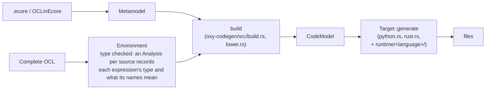

# Code generation

Oxychloride generates native code from a metamodel (an `.ecore` file or an OCLinEcore document) — like EMF's Java generator, but for **Python** and **Rust**, and with the **OCL translated** too:

- the domain model: one class (Python) or handle type (Rust) per `EClass`, enumerations, typed features with defaults, containment and bidirectional references kept consistent, deletion;
- XMI loading and saving, compatible with EMF's (and Oxychloride's) XMI;
- validation: the bounds of the features and the OCL **invariants** (with their messages);
- operations with OCL **bodies**, checked against their **pre- and postconditions** at every call;
- OCL **derived features**, **initial values** and the `def:` attributes and operations of Complete OCL documents.

The generated code does not use the OCL engine: each target copies a small runtime (the OCL standard library, the XMI reader and writer, the bookkeeping of references) into the output, so the result has no dependencies besides the language's standard library.

## Generating code

**VS Code** — right-click an `.ecore` or `.oclinecore` file (Explorer or editor), or a package in the *Metamodels* view, and choose **Generate Code…**: pick the language, then the folder (the folder used last for the metamodel is suggested). The OCL comes from the metamodel and from the Complete OCL documents of the workspace. Settings: `oxychloride.codegen.target` (`python`, `rust`; empty: ask) and `oxychloride.codegen.outputFolder` (absolute or relative to the workspace folder, e.g. `generated`; empty: ask). Constructs the target cannot translate are listed in the *Oxychloride* output.

**Command line**:

```sh
oxy generate examples/library/library.ecore -d examples/library/library.ocl -t python -o generated
oxy generate examples/university/university.oclinecore -t rust -o generated --name university_model
```

`-d` adds Complete OCL documents, `--name` names the package or crate (default: the first package's name), `--map PREFIX=DIR` maps `pathmap://` URIs as for the other commands. The exit code is 1 if some OCL could not be translated (the warnings say which).

**Protocol** — `codeTargets` lists the languages, `generateCode` returns the files (see [PROTOCOL.md](PROTOCOL.md#code-generation)). From Rust: `Workspace::generate_code`, or `oxy_codegen::generate` on a `Metamodel` and a compiled `Environment`.

The packages the selected metamodel depends on (supertypes and types from other `.ecore` files) are generated into the same output; Ecore's own classes (`EObject`, …) become untyped objects.

## Python

```text
generated/library/__init__.py    re-exports the classes and the API below
generated/library/_model.py      all classes and enumerations
generated/library/library.py     the classes of one EPackage (one module per package)
generated/library/_runtime.py    the runtime (copied)
```

Python 3.9 or later, no dependencies. Put the folder on the path (or copy the package into your project) and:

```python
from library import Library, Book, Member, Loan, Genre, load, dumps, validate, ContractViolation

lib = Library(name="City Library")
dune = Book(name="Dune", isbn="978-0441013593", copies=2, genre=Genre.FICTION)
lib.books.append(dune)              # containment: dune.library is lib now
alice = Member(name="Alice", age=34)
lib.members.append(alice)
loan = Loan(book=dune)
loan.member = alice                 # opposite: alice.loans contains loan now
lib.loans.append(loan)

for d in validate(lib):             # multiplicities and invariants of lib and its contents
    print(d)                        # e.g. "Book::HasIsbn violated on Book 'X': Book 'X' has no ISBN"

print(dune.loan_count, dune.is_available(), dune.borrowers)   # derived, operation, def:
print(dumps(lib))                   # XMI; load("file.xmi") / loads(text) read it back

resource = load("library.xmi")      # a Resource: .contents (roots), .warnings, .save(path)
```

- **Classes** derive from `_runtime.EObject`; abstract classes cannot be instantiated. Keyword arguments set features. Feature names are snake_case (`loanCount` → `loan_count`); the reflective `e_get("loanCount")`/`e_set` use the metamodel's names.
- **Features** are descriptors. Single-valued ones are plain attributes (`None` when unset); many-valued ones are lists that keep containment and opposites consistent (`append`, `insert`, `remove`, `extend`, `clear`, assignment of a list). Adding an object to a containment feature removes it from its previous container. Unique features ignore duplicates.
- **Derived features** (OCL `derivation`) and `def:` attributes are read-only properties; `def:` operations are methods.
- **Operations** are methods. With pre- or postconditions, a call checks them and raises `ContractViolation` (with `kind`, `constraint`, `object`, `message`, `status`) when one does not hold; `set_contract_checking(False)` turns that off. An operation without an OCL body raises `NotImplementedError`: implement it by overriding `_impl_<name>` in a subclass (the contracts still apply), or the method itself.
- **Invariants** are methods `check_<name>()` returning a bool; `validate(obj | resource | list)` returns `Diagnostic`s (`object`, `constraint` like `Book::HasIsbn`, `kind` `invariant` or `multiplicity`, `status` `violated` or `error`, `message`).
- **Model access**: `e_container()`, `e_contents()`, `e_all_contents()`, `e_resource()`, `e_delete()` (removes the object and its contents from every reference), `e_class()`.
- **OCL values**: `null` is `None`, `invalid` is the exception `OclInvalid` (raised by failing expressions, e.g. `first()` of an empty collection, division by zero), collections are lists, tuples are `_runtime.Tuple`, `*` is `math.inf`, enumeration literals are `Enum` members ordered as declared (`Genre.FICTION.literal` is the serialized form).

## Rust

```text
generated/library/Cargo.toml
generated/library/src/lib.rs        Model (the object store), Class, metadata, XMI, validate
generated/library/src/library.rs    the enumerations and handle types of one EPackage
generated/library/src/ocl.rs        runtime: the OCL library, errors, handles (copied)
generated/library/src/ecore.rs      runtime: links, XMI, multiplicities (copied)
generated/library/src/xml.rs        runtime: XML reader (copied)
```

A crate without dependencies (edition 2021, Rust 1.70 or later). Add it as a path dependency:

```rust
use library::*; // the items of every package are re-exported at the crate root

let mut m = Model::new();
let lib = m.create_library();
lib.set_name(&mut m, Some("City Library"));
let dune = m.create_book();
dune.set_name(&mut m, Some("Dune"));
dune.set_copies(&mut m, 2);
lib.add_to_books(&mut m, dune);                  // dune.library(&m) == Some(lib) now
assert_eq!(dune.library(&m), Some(lib));

for d in m.validate() {                          // every object: multiplicities, invariants
    println!("{d}");
}
let available: bool = dune.is_available(&m)?;   // operations return ocl::Result<T>
let count: i64 = dune.loan_count(&m)?;           // so do derived features and def:s

let (loaded, warnings) = Model::load_xmi("library.xmi")?;
let root: Library = loaded.cast(loaded.roots()[0]).unwrap();
std::fs::write("copy.xmi", loaded.to_xmi())?;
```

- **Objects** live in a `Model` and are referred to by typed **handles** (`Book`, `Member`: `Copy` wrappers of an `ObjectId`). A handle of a class may refer to an object of a subclass; `m.cast::<T>(o)` checks and converts, `Sub::into()` upcasts. `m.create_<class>()` creates objects (without a container: roots until added somewhere), `m.delete(o)` deletes an object and its contents and removes them from all references.
- **Features** are methods of the handles, for inherited features too. Getters take `&Model`: `name(&m) -> Option<&str>`, `copies(&m) -> i64`, `authors(&m) -> &[Author]`, `library(&m) -> Option<Library>`. Setters take `&mut Model` and keep containment and opposites consistent: `set_name`, `set_library`, `add_to_books`, `remove_from_books`, `set_books`. Values that may be absent are `Option`s (see *Types* below).
- **Operations, derived features, `def:`s and invariants** (`check_<name>`) return `ocl::Result<T>`: `Err(Error::Invalid(reason))` is OCL's `invalid`; `Err(Error::Contract(violation))` is a pre- or postcondition that failed at a call (unless `m.check_contracts` is false). An operation without an OCL body returns invalid ("has no OCL body"): give it a body in OCL. Overriding operations dispatch on the object's class.
- **Validation**: `m.validate()` and `m.validate_object(o, &mut out)` return `Diagnostic`s (`object`, `label`, `constraint`, `kind`, `violated`, `message`; `Display` prints them like Oxychloride does).
- **Reflection**: `CLASSES`, `FEATURES`, `PACKAGES`, `ENUMS` describe the metamodel; `ecore::Store` (implemented by `Model`) reads and writes features by index — what the XMI code uses.
- **Model access**: `m.roots()`, `m.objects()`, `m.class_of(o)`, `m.container_of(o)`, `m.contents(o)`, `m.all_contents(o)`, `m.all_instances::<T>()`, `m.label(o)`, `m.uri_fragment(o)`, `Model::from_xmi`/`load_xmi`/`to_xmi`/`save_xmi`.

## Types

| OCL / Ecore | Python | Rust |
|---|---|---|
| Boolean (`EBoolean`) | `bool` | `bool` |
| Integer (`EInt`, `ELong`, `EBigInteger`, …) | `int` | `i64` (overflow is invalid) |
| Real (`EDouble`, `EFloat`, `EBigDecimal`) | `float` | `f64` |
| String, other data types | `str` | `String` |
| enumeration | `Enum` subclass | `enum` (`Copy`, ordered) |
| class | class | handle (`Copy`) |
| `EObject`, `OclAny` | `EObject` | `ObjectId` |
| collection, many-valued feature | `list` | `Vec<T>` |
| UnlimitedNatural `*` | `math.inf` | `i64::MAX` |
| tuple | `_runtime.Tuple` | tuple of the parts in name order (`Option`s, `Vec`s for collections) |

**Nullability** (Rust `Option`, Python `None`): single-valued references are always optional (unset until linked; validation checks their lower bound). Attributes of Java primitive types (`EInt`, `EBoolean`, `EDouble`, …) and enumerations always have a value: their default literal, else `0`, `false`, `0.0`, the first literal. Other attributes (`EString`, `EBigInteger`, data types) are optional if their lower bound is 0, else they default to `""`/`0`. Parameters and results are optional if their lower bound is 0.

## OCL semantics, and where the targets differ

The translation follows the engine's evaluator (`crates/oxy-ocl/src/eval.rs`), and `crates/oxy-codegen/tests/conformance.rs` checks it: some 160 expressions — numbers, strings, every collection operation and iterator, navigation, type tests, operations and definitions, tuples, `let`, `if`, `iterate`, initial values, null and invalid — evaluate to true in the engine, and in the generated code of every target. Differences:

- **Strictness** — both targets evaluate left to right and stop at the first failure: `invalid and false` is invalid (OCL: false), `if null then …` takes the else branch in Python (OCL: invalid). `forAll`/`exists` do continue past failing elements as OCL requires.
- **`@pre`** evaluates to the current value, as in the engine (OCL queries have no side effects).
- **Python** has no static types: values are what they are at run time. Navigating from `None`, or comparing it with `<`, raises an exception, which `validate` and contract checks report as invalid.
- **Rust** collections cannot contain null: `collect` leaves out null values (OCL keeps them, and a later navigation from them is invalid). Not supported: regular expressions (`matches`, `replaceAll`, `replaceFirst`: the crate has no dependencies), `oclType()`, the text (`toString()`) of tuples. Unsupported constructs are reported when generating, and evaluate to invalid.
- **XMI**: references to other documents (`href="other.xmi#…"`) are not followed (a warning per reference); EMF's `//@feature.index` fragments, multi-root documents, `xmi:id`s and `iD` attributes are supported.

`allInstances()` covers the model (Rust) or the resource of the object it is called from, or the objects contained by its root object if it is in none (Python).

## How it works



1. **Analysis** (`oxy-ocl`): the type checker records, per expression id, its static type and how it resolved each name, property and call (`oxy_ocl::resolution`): a variable, a property of `self` or of an implicit iterator (and which), a feature, a `def:`, an operation of the metamodel, a library operation, an implicit collect. Generators read this instead of re-implementing OCL's resolution rules.
2. **Build** (`build.rs`): the selected packages and their dependencies become a `CodeModel` (`model.rs`): packages, classes (with all supertypes and features), enumerations, features (typed, with nullability and defaults), operations (with the operations they override), invariants, derivations, bodies, contracts and `def:`s. Elements refer to each other by index; nothing refers back to the metamodel.
3. **Lowering** (`lower.rs`): each OCL body becomes an `Expr` tree that is resolved and typed: implicit `self` and iterator variables are explicit (`_1`, `_2`, …), `coll.name` is a `collect`, `x->op()` on a single value is `x.oclAsSet()->op()`, library operations have canonical names (`library.rs`), variables have unique names. OCL with errors, or that cannot be translated, becomes an `Invalid` node and a warning.
4. **Targets** (`python.rs`, `rust.rs`) print the code model and copy their runtime (`crates/oxy-codegen/runtime/<language>/`, embedded with `include_str!`).

## Adding a target language

Targets are self-contained: the protocol, the CLI and VS Code discover them through `oxy_codegen::TARGETS` (`codeTargets`), so a new language needs no changes outside `crates/oxy-codegen` and the docs. Checklist (Python is the simpler example to follow, Rust the statically typed one):

1. **Module.** Create `crates/oxy-codegen/src/<language>.rs` with a unit struct implementing `Target`: `id()` (lower case, used by `--target` and the protocol), `name()`, `description()` (one sentence) and `generate(&self, model: &CodeModel, options: &Options, output: &mut Output)`. Add `pub mod <language>;` to `lib.rs` and the struct to `TARGETS`.
2. **Runtime.** Write the parts that do not depend on the metamodel as ordinary source files under `crates/oxy-codegen/runtime/<language>/` — the OCL library operations (`library::OPERATIONS` lists them with their semantics), the bookkeeping of containment and opposites, XMI reading and writing (EMF's format: `xsi:type`, attributes for values and non-containment references, elements for contained objects, `//@feature.index` fragments, `xmi:XMI` for several roots), multiplicity checks. Embed them with `include_str!` and emit them with `output.file(path, text)`. Keep them dependency-free, and test them through the generated code (below).
3. **Names.** All files go below one folder named after `options.name` or `model.name` (`naming::snake_case`). Make identifiers valid and unique: a keyword list plus `naming::Names` (see `python::PyNames`, `rust::RsNames`). Name members class by class with supertypes first (`python::class_order`) so that inherited members keep their names, and remember that operations overriding an inherited one must keep its name.
4. **Structure.** For every class: its features (`Class::all_features`; `Feature::is_stored`, `is_container`, `derivation`, `initial`, `default`, `typed.nullable`), operations (`CodeModel::all_operations`; dispatch with `implementation(class, op)`, check the contracts of `contract_operations(class, op)` — preconditions before, postconditions with `result` after the body), invariants (`Class::invariants`, with optional messages) and `def:`s (`def_attribute`, `def_operation` find inherited ones). Multiple inheritance is arbitrary in Ecore: if the language linearizes it (like Python's C3), see `python::python_bases`.
5. **Expressions.** Translate `ExprKind` exhaustively (`model.rs` documents each variant): `SelfRef`, `Result`, `Parameter`, `Var` are references; `Feature`/`DefAttribute`/`Call`/`DefCall` are always on a single object (`safe` for `?.`); `Library` names a canonical operation of `library::OPERATIONS` (its `source` is a collection for collection operations); `Iterator` has one variable except `forAll`/`exists`; `Type` appears as the argument of `oclIsKindOf`, `oclIsTypeOf`, `oclAsType`, `selectByKind`, `selectByType`. Every node has its static type `ty`. A statically typed target needs the nullability of each expression (see `rust::RsExpr::expr_nullable`) and conversions where OCL conforms implicitly (Integer to Real, subclass to superclass, value to optional value; `rust::RsExpr::convert`).
6. **Unsupported constructs.** Never fail and never emit code that does not compile: call `output.warn(message, Some(origin))` (the origin is the `Body::origin`) and generate code that fails at run time with the reason, as OCL's `invalid`.
7. **Header.** Generated files say where they come from (`model.source`) and that they must not be edited.
8. **Tests.** Add `crates/oxy-codegen/tests/<language>.rs` like `python.rs`/`rust.rs`: generate the examples (`common::library()`, `common::university()`), build and run a small program against the generated code (skip if the toolchain is missing), and compare its output with the engine's violations. Add `<language>_agrees` to `tests/conformance.rs` (it must print `cN=true` for each check) and list the checks it cannot pass in `deviations` with the reason. Run `cargo test -p oxy-codegen` and `cargo clippy --all-targets`.
9. **Docs.** Add the language to this file (layout, API, types, differences), to the targets in [PROTOCOL.md](PROTOCOL.md#code-generation), and to the `oxychloride.codegen.target` setting's description in `vscode/package.json`.
